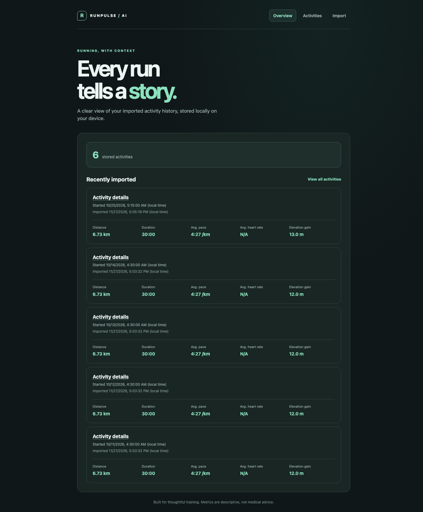
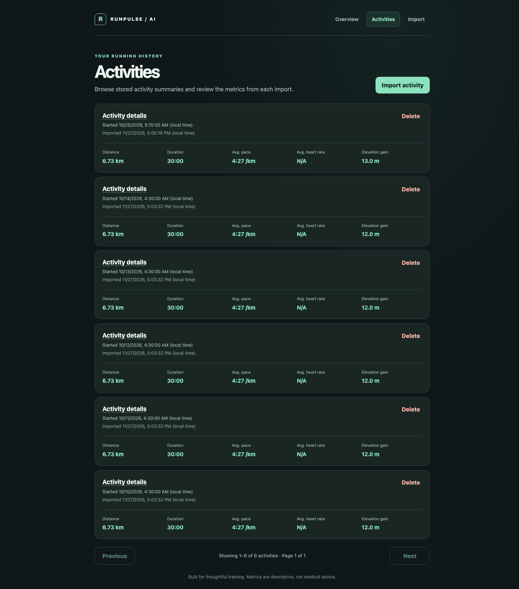
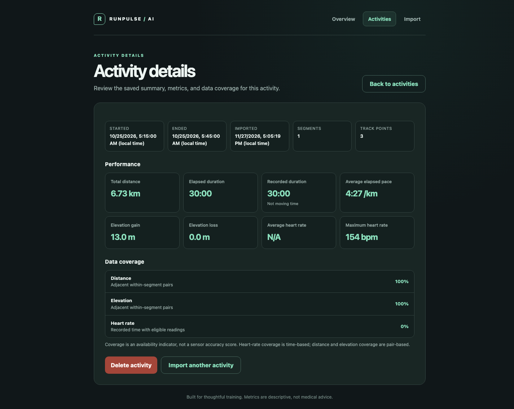
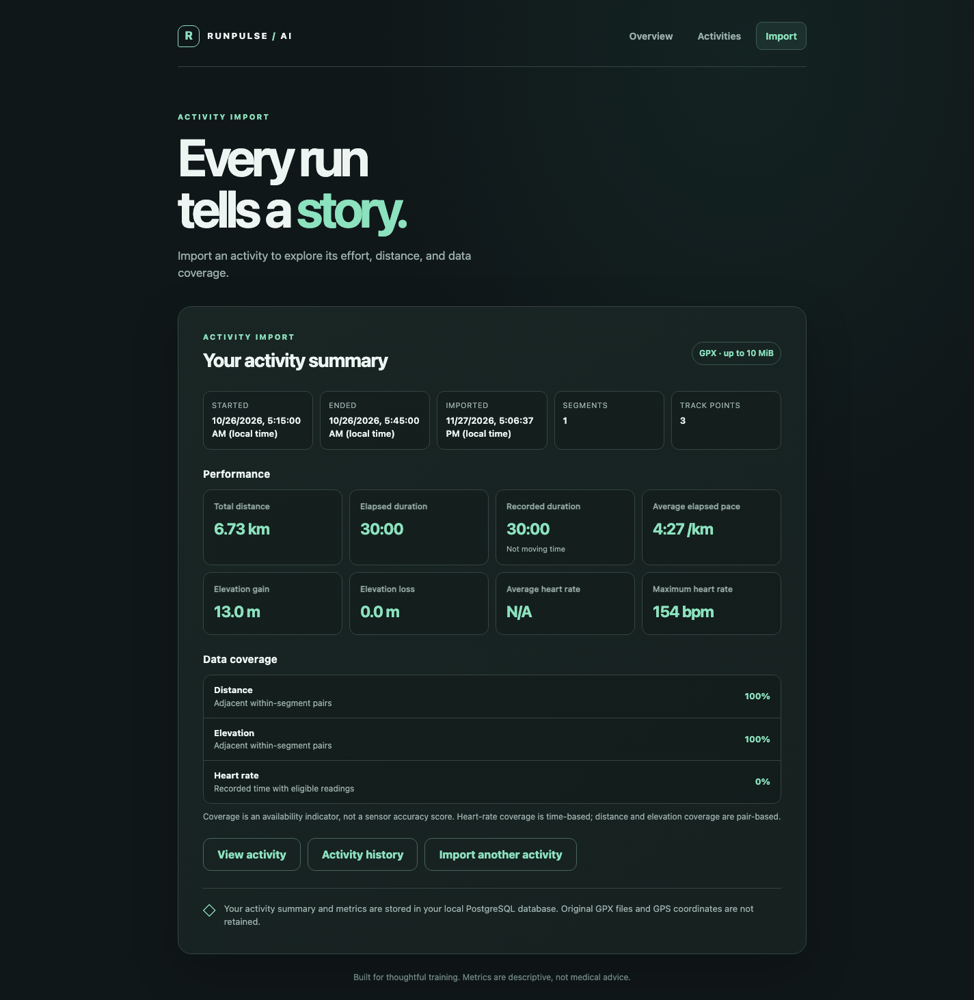
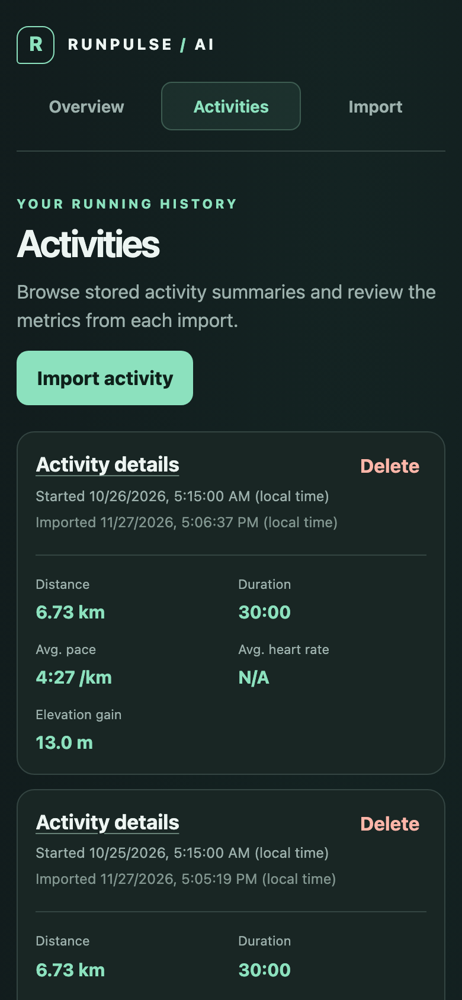
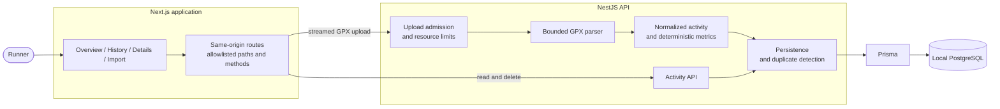

# RunPulse AI

RunPulse AI is a local-first running analytics application that turns a GPX export into a clear, persistent activity summary. It is also a portfolio project demonstrating full-stack engineering and AI-assisted development: small increments, test-first implementation, explicit security boundaries, and human acceptance testing.

The product vision is to help runners understand their training history without losing control of sensitive activity data. The current app imports and analyzes GPX activities locally; AI-powered coaching and insights are future ideas, not implemented product capabilities.

## Problem and motivation

Running data can be scattered across export files and vendor platforms, while route and health details are sensitive. RunPulse AI explores a local-first way to turn an export into an inspectable activity history without retaining raw GPS samples.

## What it does today

- Imports GPX files through a bounded, validated upload pipeline.
- Calculates deterministic activity metrics and displays coverage and data-quality warnings.
- Stores activity summaries in a local PostgreSQL database; original GPX files and GPS coordinates are not retained.
- Provides an overview, paginated activity history, activity details, and permanent activity deletion.
- Detects duplicate imports without exposing fingerprints in API responses.
- Serves the browser app and API on loopback interfaces with explicit same-origin proxy routes.

## Application screenshots

Captured from the running application with a disposable PostgreSQL 17 container backed by tmpfs and synthetic activities. No personal activity data, development records, or real GPS tracks are shown.

### Overview

The overview shows the stored activity count and recent summaries.



### Activity history

The history page presents persisted activities and backend pagination controls.



### Activity details

The detail page shows persisted metrics, timestamps, and sensor coverage.



### Successful GPX import

The import screen displays the persisted summary after a successful synthetic GPX upload.



### Mobile layout

The activity history adapts to a phone-sized viewport.



## Architecture



The Next.js server-side proxy keeps the API destination out of browser code and forwards only explicitly supported activity operations. The API validates uploads, parses GPX under resource limits, computes metrics using domain logic, and persists the resulting summary through Prisma.

## Technology

- Node.js 22.12 or later in the 22.x line, TypeScript, npm workspaces
- Next.js App Router and React
- NestJS API
- PostgreSQL 17 and Prisma
- GitHub Actions for automated checks
- Docker Compose for local PostgreSQL services

## Repository map

```text
apps/
  api/                 NestJS API, domain logic, Prisma integration
  web/                 Next.js UI and same-origin API routes
docs/
  adr/                 Accepted architectural decision records
  backlog.md           Product milestones and planned work
  product-vision.md    Product goals and scope
scripts/               Database safety policy and test tooling
compose.yaml           Local development and isolated test databases
```

## Local development

### Requirements

- Node.js 22 and npm
- Docker with Docker Compose

Use the public npm registry. To avoid relying on a global npm configuration, install with an isolated user configuration:

```bash
npm ci --userconfig=/dev/null --registry=https://registry.npmjs.org
```

Create a local environment file from the placeholders and configure unique, local-only secrets:

```bash
cp .env.example .env
```

Set the required values in `.env`, including local PostgreSQL credentials, a dedicated test database URL, and the activity fingerprint key. Generate a suitable random key locally, for example with `openssl rand -hex 32`. Never commit `.env`, credentials, fingerprints, personal activity files, or database dumps.

Start the development database and apply its migrations:

```bash
docker compose up -d postgres
npm run db:migrate:deploy
```

In separate terminals, start the API and web application:

```bash
npm run dev:api
npm run dev:web
```

Open the web application at `http://127.0.0.1:3000`; the API listens on `http://127.0.0.1:3001`.

The development services are intended for loopback access. The API does not provide authentication; do not expose either service to a public or shared network.

### Database migrations

Migration commands validate their destination before connecting. Local development migrations are restricted to the configured local development database; test migrations are restricted to the isolated test database. Remote and otherwise unauthorized destinations are rejected. Use the repository migration scripts rather than invoking Prisma migration commands with an arbitrary URL. Prisma client generation does not require a live database.

Do not use destructive reset commands on development or test data. In particular, do not remove Docker volumes to resolve a credential mismatch.

## Testing and verification

Database-independent unit tests can run without PostgreSQL:

```bash
npm run test:unit
```

The default test command includes database integration tests and requires an explicit `RUNPULSE_TEST_DATABASE_URL` for the dedicated test database:

```bash
docker compose --profile test up -d postgres-test
npm run db:migrate:test
npm test
```

The isolation guard fails closed if the test URL is absent, invalid, points at the development database, or cannot be confirmed as an approved isolated destination. The validated test URL is explicitly propagated to database-capable test processes; integration tests also guard their own entry points. Tests never fall back to `DATABASE_URL`.

The local Compose test service uses its dedicated loopback port and database identity. PostgreSQL initialization variables apply when a volume is first created; changing `.env` does not change credentials already stored in an existing test volume. Configure the test URL to match that volume's existing test credentials. If authentication fails, inspect the test-service configuration and volume history; do not reset volumes or change development credentials as a shortcut.

Other useful checks:

```bash
npm run typecheck
npm run build -w @runpulse/web
npm audit
git diff --check
```

The latest reported full-suite baseline was **130 passing tests, 0 failures, and 0 skipped**. This is a point-in-time result, not a guarantee for future changes.

## Security and privacy

- The application is designed for local, single-user use; it does not yet authenticate users or isolate multiple users.
- PostgreSQL and application services are intended to bind to loopback only. Same-origin proxy routes allowlist supported paths and HTTP methods instead of forwarding arbitrary requests.
- Upload parsing and body sizes are bounded. Database pools and history queries are also bounded.
- Persisted activity summaries contain running and health-related information. Treat the local database as sensitive.
- Original GPX files and raw GPS coordinates are not retained by the application. Use synthetic fixtures in tests and documentation; never add personal activity files to the repository.
- Fingerprints are used for deterministic duplicate detection and are not returned by the API. **Known limitation:** a PostgreSQL uniqueness violation may include a fingerprint in database error logs. API responses are sanitized, but database logging remains a separate privacy follow-up; this project does not change global PostgreSQL logging settings.
- Use synthetic activity fixtures only. Do not commit credentials, `.env` files, fingerprint secrets, personal activity files, database dumps, or generated build artifacts.

## Architectural decisions

The accepted decisions and their rationale are documented in the ADRs:

| ADR | Decision |
| --- | --- |
| [0001 — Modular monolith](./docs/adr/0001-modular-monolith.md) | Establishes the application structure and boundaries. |
| [0002 — Bounded XML ingestion](./docs/adr/0002-bounded-xml-ingestion.md) | Defines the bounded and secure GPX parsing approach. |
| [0003 — Activity metric definitions](./docs/adr/0003-activity-metric-definitions.md) | Records normalized activity and metric calculation decisions. |
| [0004 — Local activity import API](./docs/adr/0004-local-activity-import-api.md) | Documents the local API and same-origin proxy boundary. |
| [0005 — Local activity persistence](./docs/adr/0005-local-activity-persistence.md) | Documents summary persistence, deduplication, and privacy considerations. |

Consult the ADRs for detailed technical decisions rather than treating this README as a duplicate specification.

## Engineering workflow

Development is performed in small, reviewable increments:

1. Clarify acceptance criteria and inspect existing architecture before implementation.
2. Use Test-Driven Development: **Red** (a focused failing test), **Green** (the smallest passing change), then **Refactor** while keeping tests green.
3. Keep domain calculations deterministic and side-effect-free where practical; separate parsing, domain logic, persistence, and presentation.
4. Run relevant tests and type checks, review the complete diff, and update directly related documentation.
5. Complete human acceptance testing for user-visible flows. Automated tests use synthetic fixtures and the isolated PostgreSQL test database.

AI tools can assist with exploration, planning, implementation, and review. They do not replace verification or human acceptance. This describes the engineering workflow; it does not mean the application currently provides AI-generated analysis or coaching.

## Current limitations

- GPX is the supported import format; FIT files and third-party integrations are not implemented.
- The product is local-first and single-user, without authentication or multi-user data isolation.
- There is no cloud deployment, production observability, or automated backup experience.
- AI-generated training insights, coaching, predictions, and advanced trend analysis are not implemented.
- PostgreSQL may log a duplicate activity fingerprint when enforcing uniqueness; see [Security and privacy](#security-and-privacy).

## Future roadmap

These are planned ideas, not current features or delivery commitments:

- AI-powered training insights and a personalized running assistant.
- Performance trends, race-time predictions, and training-load analytics.
- FIT file support.
- Garmin and Strava integrations.
- Authentication and multi-user isolation.
- AWS deployment and observability.

The project backlog is tracked in [`docs/backlog.md`](./docs/backlog.md). Milestone numbering and scope there remain authoritative.
